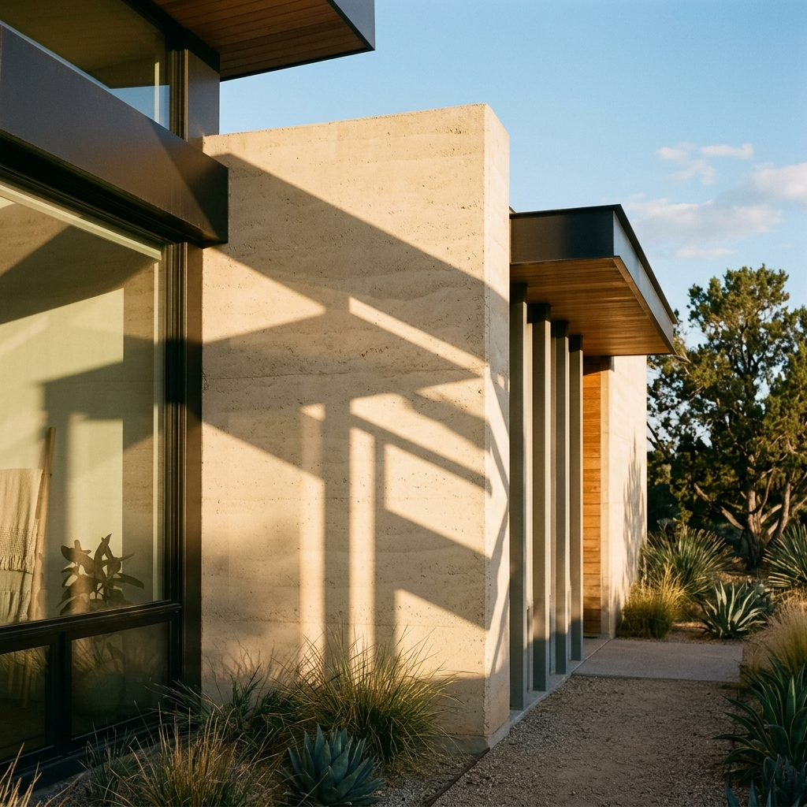
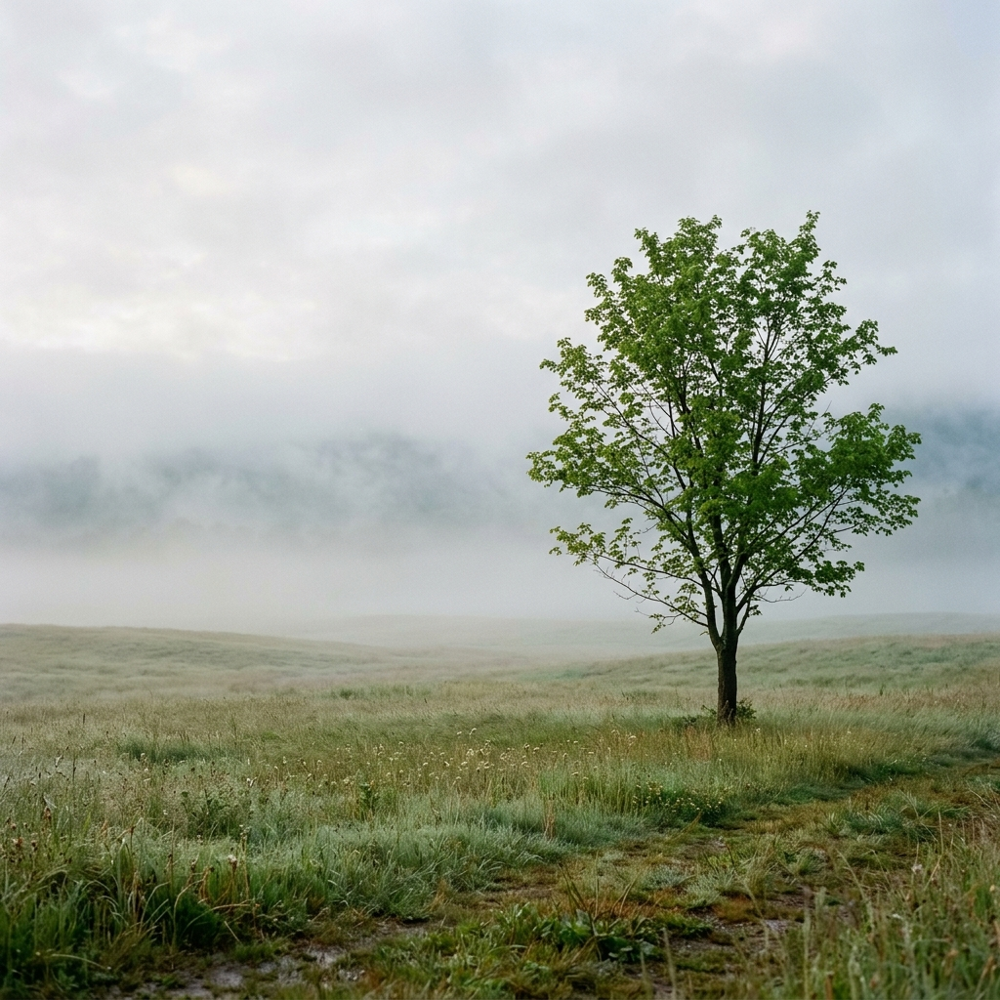
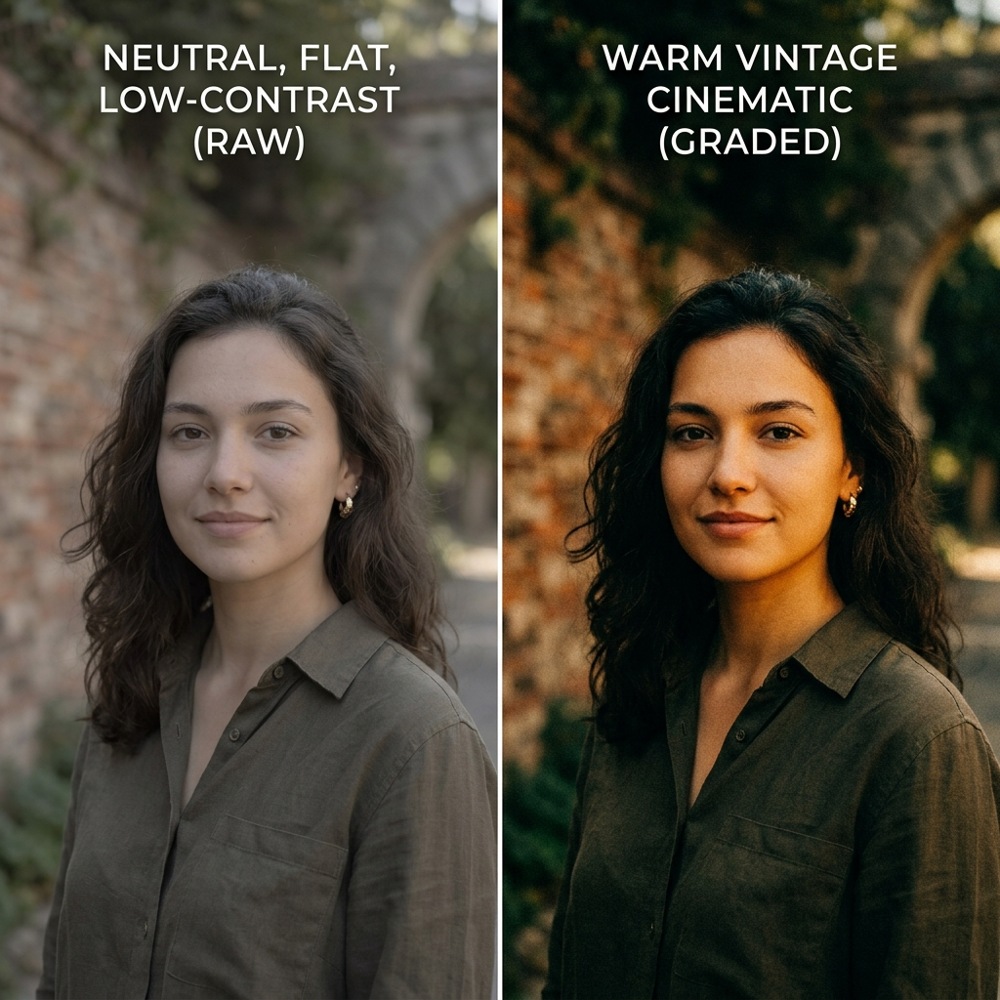
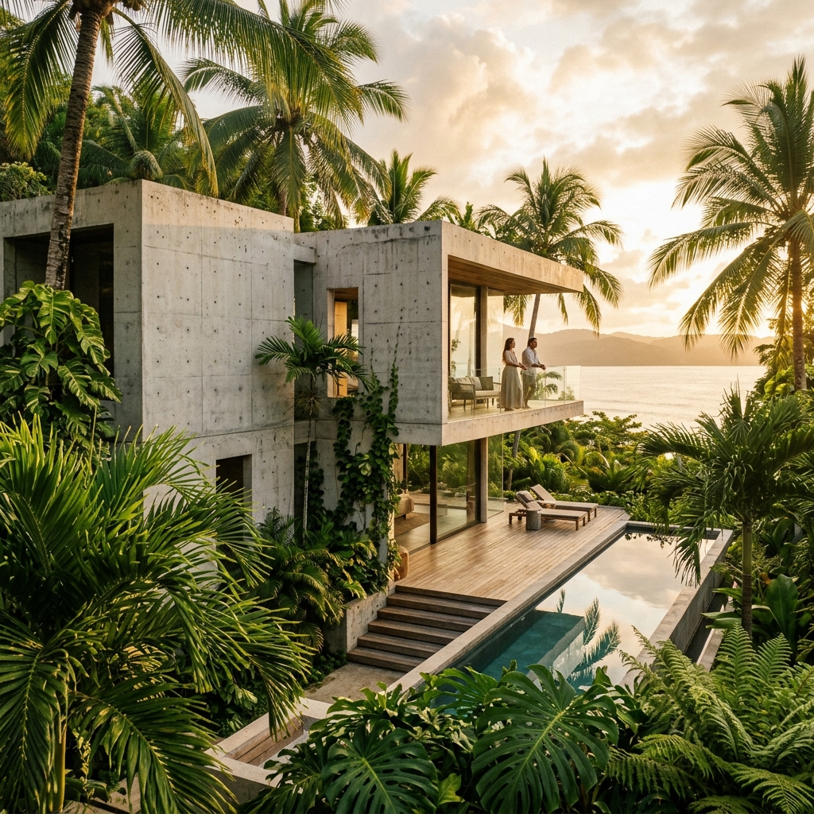

<div align="center">



# 📸 PhotoFlow

**A professional-grade Android camera app built with modern Jetpack Compose**

[](https://kotlinlang.org)
[](https://developer.android.com/compose)
[](https://developer.android.com/training/camerax)
[](https://developer.android.com)
[](LICENSE)

</div>

---

## ✨ About

PhotoFlow is a fully-featured Android camera and photo editing application, designed with a **dark glassmorphism aesthetic** and **amber/gold design language**. Built from scratch using modern Android development practices, it delivers a premium photography experience across camera capture, creative editing, collage making, and album management.

> Developed as a personal project to explore the full Android CameraX API and push the boundaries of what Jetpack Compose can render in real time.

---

## 📱 Screenshots

<div align="center">

| Onboarding | Features | Tips & Lessons |
|:---:|:---:|:---:|
|  |  |  |

</div>

---

## 🚀 Features

### 📷 Camera
- **CameraX** real-time preview with pinch-to-zoom and tap-to-focus
- **Burst mode** for rapid sequential capture
- **Self-timer** (3s / 5s / 10s) with animated countdown
- **Aspect ratio** control (1:1, 4:3, 16:9)
- **Pro Controls**: Manual ISO, Shutter Speed, White Balance & Focus

### 🎨 Creative Filters & Retro Effects
- 10+ real-time creative filters applied to the live preview
- **Grain overlay**, **Light Leak**, **Date Stamp**, **Vintage Frames**
- Non-destructive filter stack — toggle on and off freely

### 🎬 Video
- Full video recording with **slow-motion** mode
- **HDR** and **Night Mode** video capture
- In-app video scrubber in the album viewer

### 🤖 AI-Powered Editor
- **Auto-Enhance V2** with scene detection (landscape, portrait, macro...)
- **Face Retouch** — smooth, natural skin enhancement
- **Style Match** — apply the aesthetic of a reference photo
- **Vintage Restoration** — bring old photos back to life

### ✏️ Photo Editor
- **Tone Curves** with RGB channel control
- **Histogram** for exposure analysis
- **Presets** library with one-tap application
- **Before/After Compare** view

### 🖼️ Collage Maker
- Multiple grid layouts for 2 to 6 photos
- Drag-to-rearrange photos within the layout

### 🗂️ Album & Gallery
- Smart album with **Favorites**, **Videos**, **Recents**
- **Slideshow** mode with crossfade transitions
- Full-screen viewer with pinch-to-zoom

### 🎓 Onboarding & Tips
- Beautiful swipe-based onboarding with 3 illustrated screens
- **Photo Tips & Lessons** screen with photography techniques

---

## 🏗️ Architecture & Tech Stack

```
📦 PhotoFlow
 ┣ 🧭 Navigation — Jetpack Navigation3 with type-safe serializable NavKeys
 ┣ 🏛️ Architecture — MVVM with ViewModel + StateFlow
 ┣ 📷 Camera — CameraX (Preview, ImageCapture, VideoCapture)
 ┣ 🎨 UI — 100% Jetpack Compose + Material3
 ┣ 🖌️ Design — Custom glassmorphism components (BentoCard, GlassComponents)
 ┗ 🔤 Typography — Inter font family
```

| Layer | Technology |
|---|---|
| Language | Kotlin 2.x |
| UI Framework | Jetpack Compose + Material3 |
| Camera | CameraX |
| State Management | ViewModel + StateFlow + collectAsStateWithLifecycle |
| Navigation | Navigation3 (serializable NavKeys) |
| Image Loading | Coil 3 |
| Build System | Gradle (KTS) |
| Min / Target SDK | 31 / 36 |

---

## ⚙️ Getting Started

### Prerequisites
- Android Studio Ladybug or newer
- JDK 17+
- Android SDK 36
- A physical or virtual device running Android 12+ (API 31)

### Clone & Build

```bash
git clone https://github.com/JuanSsilva07/bestPhoto.git
cd bestPhoto
```

Open in **Android Studio**, let Gradle sync, then run on your device or emulator.

Or build from the terminal:

```bash
./gradlew assembleDebug
```

The APK will be at `app/build/outputs/apk/debug/app-debug.apk`.

### Permissions Required
The app requests the following permissions at runtime:
- `CAMERA` — for live preview and capture
- `RECORD_AUDIO` — for video recording
- `READ_MEDIA_IMAGES` / `READ_MEDIA_VIDEO` — for album access

---

## 📁 Project Structure

```
app/src/main/java/com/example/aestheticcamera/
 ┣ ui/
 ┃ ┣ camera/          # CameraPreview, CameraViewModel, controls
 ┃ ┣ editor/          # PhotoEditor, ToneCurves, Histogram, AIEditor
 ┃ ┣ album/           # AlbumScreen, PhotoViewer, VideoPlayer
 ┃ ┣ collage/         # CollageMaker with layout engine
 ┃ ┣ onboarding/      # OnboardingScreen, TipsScreen
 ┃ ┗ components/      # GlassCard, BentoCard, shared Composables
 ┣ navigation/        # NavKeys, AppNavigation
 ┗ theme/             # Color, Typography, Shape, GlassTheme
```

---

## 🤝 Contributing

Pull requests are welcome! If you'd like to contribute:

1. Fork the repository
2. Create your feature branch: `git checkout -b feature/my-feature`
3. Commit your changes: `git commit -m 'feat: add my feature'`
4. Push to the branch: `git push origin feature/my-feature`
5. Open a Pull Request

---

## 📄 License

This project is licensed under the **MIT License** — see the [LICENSE](LICENSE) file for details.

---

<div align="center">

Made with ❤️ by [Juan Silva](https://github.com/JuanSsilva07)

⭐ If you found this project interesting, consider giving it a star!

</div>
